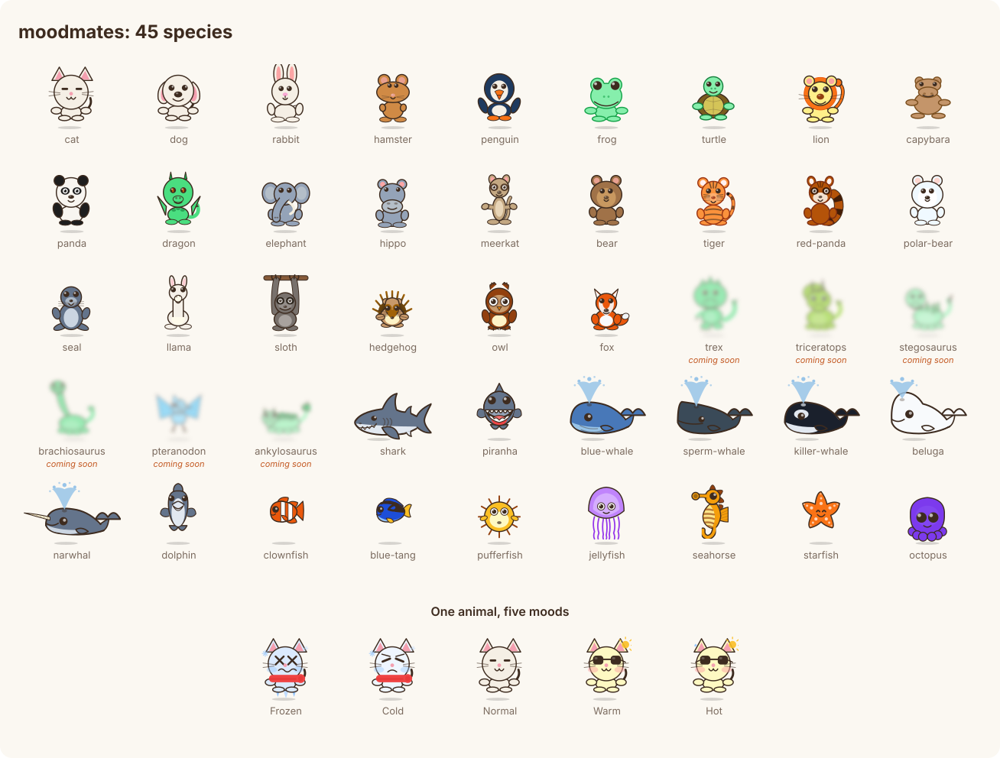

# moodmates

Small animated SVG animals that show a mood. 45 species, speech bubbles, a mood history bar.
For React 19, no runtime dependencies, no Tailwind needed.

**[Live demo](https://picookie.github.io/moodmates/demo/)**: all 45 species, every mood, search, speech bubbles.



**Honest scope:** the moods are a five-step cold-to-hot scale (`frozen`, `cold`, `neutral`, `warm`, `hot`),
and the drawings (icicles, scarf, sunglasses, sweat drops) and default phrases are built around it. It fits
anything you can place on a cold-to-hot axis: a temperature, room climate, CPU or server load (cold = idle,
hot = overloaded), a comfort level. It is **not** a general emotion set yet. Moods like sad, angry and happy,
more events and more generic phrases are planned, see [IDEAS.md](IDEAS.md).

The package knows moods, not data: your app decides which value leads to which mood.

```tsx
import { Moodmate } from 'moodmates';
import 'moodmates/styles.css';

<Moodmate type="cat" mood="warm" name="Mimi" />
```

## Install

```sh
npm install moodmates
```

Peer dependency: `react ^19`. Import `moodmates/styles.css` once in your app.

## Moods

`'frozen' | 'cold' | 'neutral' | 'warm' | 'hot'`. `hot` looks like `warm`, plus sweat drops and its own phrases.
You map your data to a mood. For example, from a temperature:

```ts
import type { Mood } from 'moodmates';

function moodFromTemperature(celsius: number | null): Mood {
  if (celsius === null) return 'neutral';
  if (celsius < 0) return 'frozen';
  if (celsius < 8) return 'cold';
  if (celsius < 22) return 'neutral';
  if (celsius < 28) return 'warm';
  return 'hot';
}
```

## Components

### `<Moodmate>`: the living animal

Blinks, hops, shivers, talks from time to time and reacts to a tap.

| Prop | Type | Default | |
|---|---|---|---|
| `type` | `PetType` | required | One of 45 species, see `ALL_PET_TYPES` (six are still [coming soon](#coming-soon)) |
| `mood` | `Mood` | required | Look, phrases and hopping follow it |
| `size` | `number` | `80` | Pixels |
| `name` | `string` | none | Name tag below the animal |
| `event` | `{ kind: EventKind } \| null` | none | Shows an event bubble and hops three times (`'first-frost'`, `'first-summer'`, `'heat-record'`, `'back-online'`) |
| `messages` | `Partial<PetMessages>` | English | Your own texts, see below |

### `<MoodmateSprite>`: just the picture

No timers, no bubble, no name. For lists, avatars and pickers.

```tsx
<MoodmateSprite type="owl" mood="cold" size={52} />
```

Props: `type` (required), `mood` (required), `size`, `blinking`, `messages` (only used for the screen reader label).
An unknown `type` falls back to the cat.

### `<MoodHistoryBar>`: a colored bar with one segment per hour

```tsx
<MoodHistoryBar moods={['cold', 'cold', 'neutral', 'warm', 'hot']} />
```

## Your own texts (and other languages)

English is the default (`MESSAGES_EN`). To use another language, pass a `PetMessages` object.
Missing fields fall back to English. Copy `MESSAGES_EN` from `src/messages.en.ts` as a template:

| Field | Content |
|---|---|
| `speech` | Phrases per mood (`frozen`, `cold`, `neutral`, `warm`, `hot`) |
| `events` | Phrases per event kind |
| `moodLabels` | Names of the moods (legend, tooltips, screen reader) |
| `petNames` | Display name per species |
| `spriteLabel(petName, moodLabel)` | Screen reader label of the picture, e.g. "Cat: Warm" |
| `tapPet` | Screen reader label of the tappable animal |
| `moodBarAriaLabel`, `moodBarHourTitle(hour, label)` | Labels of the history bar |

```tsx
const german: Partial<PetMessages> = { tapPet: 'Tier antippen', moodLabels: { /* ... */ } };
<Moodmate type="cat" mood="neutral" messages={german} />
```

## Styling

`moodmates/styles.css` is self-contained (classes are prefixed with `mm-`, `prefers-reduced-motion` is respected).
Two CSS variables: `--mm-name-color` (name tag) and `--mm-legend-color` (history bar legend).

## Without React

`moodmates/core` has no React and no CSS: `ALL_PET_TYPES`, `COMING_SOON_PET_TYPES`, `randomPetType()`, `pickMessage()`,
`pickEventMessage()`, `resolveMessages()`, `MESSAGES_EN` and the types. Useful on a server.

## Coming soon

The six dinosaurs (`trex`, `triceratops`, `stegosaurus`, `brachiosaurus`, `pteranodon`, `ankylosaurus`) are
usable but not finished yet: the drawings may still change. The demo and the picture above show them blurred.
`COMING_SOON_PET_TYPES` lists them, and `randomPetType()` does not pick them. Once a species is done it
leaves that list.

## Limitations (0.x)

- The mood scale is cold-to-hot only, and the event kinds are a fixed list (`first-frost`, `first-summer`,
  `heat-record`, `back-online`). The default phrases are weather flavored; pass your own via `messages`.
- `Moodmate` talks, blinks and hops on a fixed schedule. There is no switch to turn the speech off yet;
  use `MoodmateSprite` for a silent picture.
- All 45 species are in one bundle (about 173 kB minified, 31 kB gzip).
- The API may still change before 1.0.

## Accessibility

Every animal is an SVG with `role="img"` and a label made from `petNames`, `moodLabels` and `spriteLabel`.
The tappable `Moodmate` is a button labeled by `tapPet`. With `prefers-reduced-motion`, shivering, hopping and the bubble animation are turned off (blinking and the timing of the speech still run).
This is covered by unit tests, not yet by tests with real screen readers.

## Development

```sh
pnpm install
pnpm test          # unit tests
pnpm lint && pnpm typecheck
pnpm build && pnpm test:dist   # build and smoke-test the built package
pnpm build && pnpm gen:overview   # regenerate docs/moodmates.svg (the picture at the top; test:dist fails if it is stale)
```

## License

MIT, see [LICENSE](LICENSE). Roadmap, ideas and design decisions: [IDEAS.md](IDEAS.md).

This is a hobby project. It is not affiliated with any other product or company that uses a similar name.
